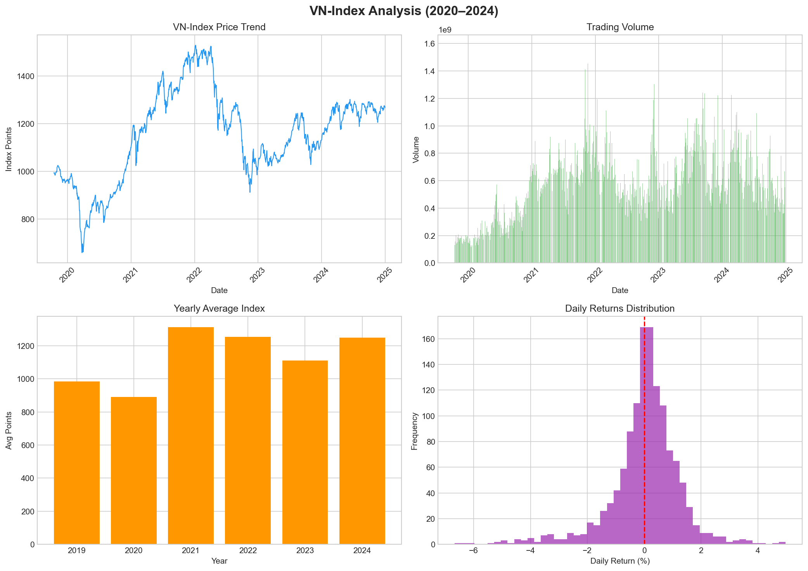

# 📈 Vietnam Stock Market Analysis — VN-Index

Exploratory Data Analysis (EDA) on Vietnam's VN-Index stock market data
from 2019 to 2024, using Python and the vnstock library.

---

## 📊 Key Findings

| # | Insight |
|---|---------|
| 1 | All-time high: **1,528.57 points** on 2022-01-06 |
| 2 | All-time low: **659.21 points** on 2020-03-24 (Covid-19 crash) |
| 3 | Average daily return: **+0.027%** |
| 4 | Most volatile year: **2022** (market correction) |
| 5 | Average daily trading volume: **565,891,670** |

---

## 📈 Visualizations



---

## 🛠️ Tech Stack

- **Python 3.x**
- **vnstock** — Vietnam stock market data library
- **pandas** — data cleaning & analysis
- **matplotlib** — visualization

---

## ⚙️ How to Run
```bash
git clone https://github.com/pn849222-hub/vietnam-stock-analysis.git
cd vietnam-stock-analysis
pip install vnstock pandas matplotlib seaborn
python vnindex_analysis.py
```

---

## 💡 Market Insights

1. VN-Index crashed **-57%** during Covid-19 (Jan→Mar 2020)
2. Strong recovery and peaked at **1,528 points** in early 2022
3. 2022 was the most volatile year — market correction of ~33%
4. Trading volume increased significantly from 2021 onwards

---

## 📂 Data Source

- **Library:** [vnstock](https://github.com/thinh-vu/vnstock) — free Vietnam stock data
- **Symbol:** VNINDEX
- **Period:** 2019–2024 | **Records:** 1,307 trading days

---

*Part of a Data Analytics portfolio for OJT applications.*